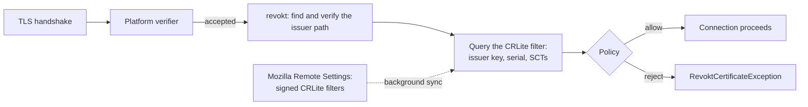

<!-- SPDX-FileCopyrightText: 2026 revokt contributors -->
<!-- SPDX-License-Identifier: Apache-2.0 -->

# revokt

revokt, a Kotlin TLS revocation library, is not affiliated with Revokt (revokt.com).

**Browser-grade TLS revocation checking for the JVM and Android, in pure Kotlin.**

[](https://github.com/geota/revokt/actions/workflows/ci.yml)
[](https://securityscorecards.dev/viewer/?uri=github.com/geota/revokt)
[](LICENSE)
[](https://kotlinlang.org)
[](#platform-support)
[](https://reuse.software)


revokt is designed to read Mozilla's signed
[CRLite](https://blog.mozilla.org/security/2020/01/09/crlite-part-1-all-web-pki-revocations-compressed/) filters and
answer "is this certificate revoked?" on every TLS handshake. It will run after the platform verifier, make no
per-connection network lookups, and install into OkHttp or any Ktor engine with one line each. Later milestones grow
it into a Web PKI client-policy library: OneCRL, Chrome CRLSets, Certificate Transparency, distrust and Merkle Tree
Certificates.

> [!WARNING]
> **revokt is not production ready.** Nothing is published to Maven Central, and the API below is a design sketch
> that may change in any 0.x release; binary compatibility is promised from 1.0. The project is in milestone 0.1, the engine's foundations. The first `Revokt` facade
> lands in 0.2, and the OkHttp, Ktor and Android bindings in 0.3. See the [roadmap](ROADMAP.md) for progress.

## Why

As of October 2026, a JVM or Android client has no maintained way to consume browser-grade PKI policy data:

- **No Kotlin or Java library reads CRLite**, OneCRL, Mozilla's intermediate preload set or Chrome's CRLSets.
- **OkHttp does no revocation checking.** JSSE's OCSP and CRL support is off by default, slow, and tells the
  certificate authority which sites you visit.
- **The closest tool is [rustls/upki](https://github.com/rustls/upki)**: Rust, with a three-function C FFI and no
  Android targets.

The eMudhra compromise of October 2026, where 8 intermediate keys were recoverable from public certificates, showed
why the gap matters. revokt fills it natively, with no JNI, no `.so` and no second TLS stack.

## How it will work

This is the design the [spec](docs/spec/revokt-spec.md) sets out; the [progress](#progress) section says what exists.



1. **The platform decides acceptance first, and revokt only adds rejections.** In the default policy revokt never
   rejects because of its own failures, with two stated exceptions: a chain stuffed beyond any honest chain's size,
   and missing data you configured revokt to have.
2. **Revocation data is local.** Mozilla publishes compact filters of the revocations by CRLite-enrolled CAs, in two
   channels:
   - `DEFAULT`, about 6 MB, holds every revocation reason;
   - `COMPAT`, about 1.6 MB and the one Firefox for Android uses, holds only key compromise, cessation of operation
     and privilege withdrawn.

   revokt verifies their content signatures, keeps them on disk and updates them in the background. A check costs no
   network round trip and tells no one which site you visit.
3. **Every outcome is a named rule**, such as `REVOKED`, `NO_DATA` or `NOT_ENROLLED`, and a policy maps each rule to
   allow or reject. Two presets ship:
   - `DEFAULT` rejects what the data proves revoked, and little else.
   - `STRICT` also rejects most of what revokt cannot check. Certificates newer than the filter's coverage are allowed
     in both, since no preset can check them.

   An `OBSERVE` mode runs a policy without enforcing it, so you can measure what `STRICT` would reject before turning
   it on.

## Planned usage

> [!NOTE]
> This is the API the [spec](docs/spec/revokt-spec.md) (§4) designs. **None of it exists yet.**

```kotlin
// Gradle: the binding plus a seed for the channel, so SeedSource.bundled() finds a filter on first launch.
//   implementation("dev.revokt:revokt-okhttp:<version>")
//   implementation("dev.revokt:revokt-seed-compat:<date>")

// One instance per storage directory, started when the application starts.
val revokt = Revokt {
    channel = CrliteChannel.COMPAT                       // the smaller channel: three revocation reasons
    storage = AndroidStorage.noBackup(context, "revokt")
    sources {
        remoteSettings(MozillaRemoteSettings.DEFAULT)    // Mozilla's signed feed
        seed(SeedSource.bundled())                       // a bundled filter for the first launch
    }
    policy = RevoktPolicy.DEFAULT                        // or RevoktPolicy.STRICT
}
revokt.start()

// OkHttp: one line.
val client = OkHttpClient.Builder()
    .revokt(revokt)
    .build()
```

Ktor gets one adapter per engine: OkHttp, CIO, Java and Android. A revoked certificate fails the handshake with a
`RevoktCertificateException` carrying the `Verdict`: which rule fired, the path revokt verified and the findings
behind it.

## Features

| | Feature | Milestone |
|---|---|---|
| ✅ | Strict DER/TBS certificate parser, tested differentially against independent oracles | 0.1 |
| ✅ | Port of Mozilla's `clubcard` CRLite filter decoder, v3 and v4 encodings | 0.1 |
| 🚧 | Rule model, the two presets' tables and the growability contract (the public policy builder is 0.2) | 0.1 |
| ⏳ | `RevocationEngine`, the C2SP `index.bin` reader and writer, JSON and canonical JSON | 0.1 |
| ⏳ | Path walker, Mozilla Remote Settings with content-signature verification, in-memory updater | 0.2 |
| ⏳ | Durable store, OkHttp and Ktor bindings, Android support, WorkManager sync | 0.3 |
| ⏳ | Intermediate preloading, OneCRL, Chrome CRLSets | M2 (0.4 → 1.0) |
| ⏳ | Certificate Transparency policy | M3 |
| ⏳ | Per-anchor distrust | M4 |
| ⏳ | Merkle Tree Certificates | M5 |

✅ done · 🚧 in progress · ⏳ planned. The [roadmap](ROADMAP.md) has the detail.

## Modules

| Artifact | Platform | Contents | From |
|---|---|---|---|
| `revokt-engine` | Kotlin Multiplatform; JVM only in 1.0 | Parser, path walker, CRLite evaluation, policy, updater | 0.1 |
| `revokt-clubcard` | Kotlin Multiplatform | The CRLite filter decoder: an MPL-2.0 port, internal to revokt | 0.1 |
| `revokt-bom` | | A BOM aligning the code artifacts | 0.1 |
| `revokt-jsse` | JVM | The `Revokt` facade and its `X509TrustManager` | 0.2 |
| `revokt-okhttp` | JVM | The OkHttp 4.12+ and 5.x binding | 0.3 |
| `revokt-ktor-*` | JVM | One binding per Ktor engine | 0.3 |
| `revokt-android`, `revokt-android-work` | Android | Platform trust, storage, lifecycle and WorkManager sync | 0.3 |
| `revokt-testing` | JVM | `FakeRevokt`, fixtures and the chain generator | 0.3 |

## Platform support

- **JVM:** 17 or later. The library targets JDK 17 bytecode, and Gradle builds it on JDK 21.
- **Android** (from 0.3): API 26 or later. Consumers need AGP 8.5.2 or later, as Kotlin 2.4 already requires.
- **Kotlin:** the spec targets consumers on 2.3 or later; the consumer builds currently test 2.4.
- **Java:** a first-class consumer. Every member has a Java-friendly form: `java.time`, `CompletableFuture`,
  builders.

## Progress

The 0.1 parser track is complete. Its bar is a **differential oracle** (spec §9.2): every certificate is parsed by
revokt and by independent implementations, and a disagreement that could change a revocation answer fails the build
unless it is recorded with a written justification.

- **Oracles:**
  - the JDK on 17, 21, 25 and 27;
  - Conscrypt 2.7.0 and 2.8.0;
  - Rust's `x509-parser`;
  - a byte-level TLV locator;
  - the certificate parsing of Mozilla's CRLite producer, in Go.
- **Corpora:**
  - every certificate in [x509-limbo](https://github.com/C2SP/x509-limbo);
  - 10 347 CA certificates from CCADB, Mozilla, the JDK and Android;
  - 132 041 real certificates from CT logs and crt.sh, issued by 975 of the 1 035 CA keys in the test filters;
  - a hand-built leniency corpus.

  They are pinned in [revokt-corpus](https://github.com/geota/revokt-corpus).
- **Result:**
  - zero D1, D2, D3 and D8 violations, the 0.1 gate, on every corpus, with every recorded divergence justified in
    writing;
  - no unexpired certificate of a covered CA that Mozilla's producer can index but revokt cannot (0 of 117 603).

[`docs/dev/status.md`](docs/dev/status.md), generated by `./gradlew specStatus`, counts the §9 fixtures implemented and
reports the measured D8 gap.

## Building

```sh
./gradlew check                        # the full local gate: JDK-only and offline
./gradlew check -Prevokt.purityGate    # plus a native compile proving commonMain is pure Kotlin
./gradlew check -Prevokt.ci            # plus the consumer builds and the purity compile, as CI runs it
./gradlew check -Prevokt.corpus=<dir>  # plus the large corpus, a revokt-corpus checkout
```

Gradle runs on JDK 21. The native test oracles in `native/` need Rust and Go only to re-record goldens; the replay
reads committed results. [`docs/dev/local.md`](docs/dev/local.md) covers the local setup.

## Documentation

- [`docs/spec/revokt-spec.md`](docs/spec/revokt-spec.md): the normative design, with each decision and its evidence.
- [`ROADMAP.md`](ROADMAP.md): the milestones in plain language, with progress.
- [`docs/adr/`](docs/adr): the architecture decisions behind the spec and the process.
- [`docs/dev/`](docs/dev): the corpora, fixtures, dependencies and the keyability audit.

## Contributing

Contributions are welcome. [`CONTRIBUTING.md`](CONTRIBUTING.md) explains how work is picked from the roadmap, how it
is sized and reviewed, and which checks gate it; [`AGENTS.md`](AGENTS.md) covers AI-assisted work. Every change
starts from an issue, and the [Code of Conduct](CODE_OF_CONDUCT.md) applies.

## Security

Report vulnerabilities privately through GitHub's
[private vulnerability reporting](https://github.com/geota/revokt/security/advisories/new), never in a public issue.
[`SECURITY.md`](SECURITY.md) has the disclosure policy, and the spec's §10 lists the known residual risks.

## Licence

Apache-2.0, except `revokt-clubcard`'s port package, a translation of Mozilla's `clubcard` crates under MPL-2.0 (see
[`NOTICE`](NOTICE) and [`LICENSES/`](LICENSES)). The project follows the [REUSE](https://reuse.software)
specification.
